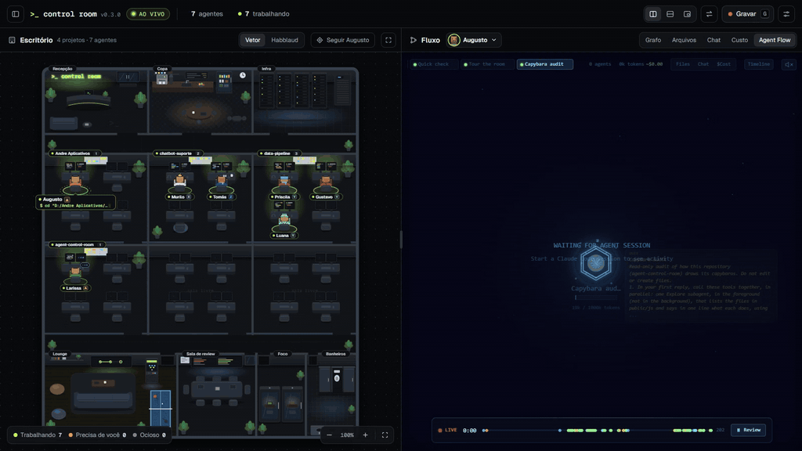

# Agent Control Room

**One screen to watch your Claude Code agents live.** On the left, an office with a room for each project and a desk for each agent, every agent a pixel-art capybara in its own outfit. On the right, the selected agent's session as a git graph: your messages, its thinking, every tool call, subagents branching off and coming back. Built on [Habblaud](https://github.com/marmottajr/habblaud) and [Agent Flow](https://github.com/patoles/agent-flow), whose own views are one click away.

[Leia em português](README.pt-BR.md)



- **The office** shows *who* is working and *how they are*: each capybara keeps its own outfit and hat (a beanie, a cap, headphones, an orange or a chick on its head), and each state has its own gesture (lime ring and code on the screens while working, a thought bubble while thinking, a raised paw and an orange ring when it needs you, a red screen on an error) and idle agents leave the desk for the kitchen. The **Habblaud** button swaps it for Habblaud's living pixel-art world, where agents walk around, play ping-pong and make friends and rivals.
- **The flow** shows *what* they do, with real numbers from the session file: context used, cost, `+/-` lines per edit, how long each command took, tools and tokens of each subagent. Tabs for **Files**, **Chat** and **Cost**, and **Agent Flow** for Agent Flow's original node graph.
- **The sidebar** puts on top whoever needs you (with the command waiting for approval), lists projects and agents, and shows each account's 5-hour and weekly limits.

Everything comes in this repository: clone it (or download the ZIP), double-click `start.cmd` and you're in. The only thing you need installed is Node.js.

This is an independent project. It ships the official builds of both tools, unmodified, runs them together and draws its own interface on top of their data.

## Features

- **One click** starts everything and opens the browser. Nothing else to install: no Docker, no separate setup of each tool.
- **Three layouts**: side by side, stacked (one above the other, made for 9:16 vertical video) and floating (the flow over the office, draggable and resizable).
- **Swap** the two panes, and **drag the divider** (double-click splits in half). Panes never reload when you change layouts.
- **Follow** an agent (the office camera keeps it in the middle) or **Locate** it from the sidebar. Zoom with the wheel or the buttons, drag to pan.
- **Play bar**: the session on a timeline. Pause freezes the flow, the timeline scrubs it, **Review session** replays it at 0.5×, 1×, 2× or 4×.
- **Record mode** hides the bars and the sidebar. Hover the top edge, press `G` or `Esc` to bring them back.
- English or Portuguese, following the browser language.

| Key | Action |
|---|---|
| `1` `2` `3` | side by side / stacked / floating |
| `T` | swap the panes |
| `G` | record mode (`Esc` leaves) |
| `/` | search agents and projects |

Shortcuts work while the room has focus. After clicking inside a pane, click the top bar first.

## Requirements

- [Node.js](https://nodejs.org/) 22.12 or newer
- [Claude Code](https://claude.com/claude-code)

Tested on Windows 11. macOS and Linux should work with `npm start`, but have not been tested yet.

## Install and run

```bash
git clone https://github.com/andrefelipevsilva/agent-control-room.git
cd agent-control-room
```

Or use **Code → Download ZIP** on GitHub and unzip it.

Then double-click **`start.cmd`** (Windows), or run `npm start`. The room opens at `http://localhost:4800/control-room/`. Open a Claude Code session in another terminal and watch it show up on both sides.

`Ctrl+C` (or closing the window) stops the room and the tools it started. A Habblaud Docker container stays on, as it normally does.

### Or let Claude Code install it

Paste this into Claude Code and it downloads the room, checks Node and opens it for you:

```text
Install and open Agent Control Room (github.com/andrefelipevsilva/agent-control-room) on my computer:
1. Check that I have Node.js 22.12 or newer (node -v). If not, show me how to install it from nodejs.org and stop here.
2. Download the repository into my home folder with git clone https://github.com/andrefelipevsilva/agent-control-room.git (without git, download and unzip the main ZIP).
3. Open the room in its own window, so it keeps running after you finish: on Windows, the folder's start.cmd by its full path; on macOS or Linux, npm start inside the folder.
4. When it opens, give me the address http://localhost:4800/control-room/
```

### Already using Habblaud with Docker?

The room finds it. If something already answers on Habblaud's or Agent Flow's port, the room uses it as is. If Docker is running and Habblaud's `habblaud` container exists, the room starts that container instead of the bundled build. `HABBLAUD_MODE=docker` or `HABBLAUD_MODE=bundled` picks one for you.

## What's in the repository

| Path | What it is |
|---|---|
| `server.mjs` | The room: starts the two tools and serves the page. Plain Node, no dependencies. |
| `session.mjs` | Reads Claude Code session files for the flow (incrementally, only what was appended). |
| `public/` | The room page: office, flow, sidebar and play bar (plain ES modules, no build step). Geist fonts under the SIL OFL. |
| `start.cmd` | Windows launcher. |
| `vendor/habblaud/` | Habblaud v1.0.3, official build, unmodified. |
| `vendor/agent-flow/` | Agent Flow v0.9.2, official build, unmodified. |
| `scripts/vendor.mjs` | Rebuilds `vendor/` from the official repositories. |

[`vendor/README.md`](vendor/README.md) lists the exact upstream commits. To check the builds yourself, or to move to newer versions, change the versions in `scripts/vendor.mjs` and run `npm run vendor` (needs git and network).

## Configuration

| Variable | Default | What it does |
|---|---|---|
| `ACR_PORT` | `4800` | Port of the room |
| `HABBLAUD_PORT` | `4747` | Port for Habblaud |
| `HABBLAUD_MODE` | `auto` | `auto`, `bundled` (always the build in `vendor/`) or `docker` (Habblaud's own container) |
| `HABBLAUD_APP` | `vendor/habblaud/dist/server/index.js` | Another Habblaud build to run instead (your own clone's `dist/server/index.js`); in `auto`, it wins over Docker |
| `AGENT_FLOW_PORT` | `3001` | Port for Agent Flow |
| `AGENT_FLOW_WORKSPACE` | picked from your recent sessions | Folder Agent Flow watches: sessions opened in it or in its subfolders appear in the graph (see below) |
| `AGENT_FLOW_TELEMETRY` | `false` | Agent Flow's anonymous telemetry, off unless you turn it on |
| `AGENT_FLOW_APP` | `vendor/agent-flow/app.js` | Another Agent Flow build to run instead |

Habblaud's own variables also work, for example `HABBLAUD_WORLD=0` (hides Habblaud World) or `HABBLAUD_PTY=1` (interactive terminal, which needs Habblaud's full install). The room turns off Habblaud's update notice (`HABBLAUD_UPDATE_CHECK=0`), because new versions arrive through this repository.

`--no-open` starts the room without opening the browser.

**Which sessions show up in Agent Flow.** Agent Flow follows one folder and its subfolders. Without a choice of yours, the room looks at the Claude Code sessions you used in the last week and picks the folder that holds most of them (for example `D:\work` when you work in `D:\work\app` and `D:\work\site`). The room's log shows the folder, and so does the tooltip of the Agent Flow light in the top bar. To choose another one: `start.cmd --workspace "D:\other\folder"` or `AGENT_FLOW_WORKSPACE`.

## How it works

```
browser ── http://localhost:4800 ── Agent Control Room (Node, 127.0.0.1 only)
                                     ├── /control-room/         → the room page
                                     ├── /control-room/session  → steps of one session, from its transcript
                                     └── everything else        → Habblaud (127.0.0.1:4747)
          iframe ─────────────────── Agent Flow (127.0.0.1:3001), in the Agent Flow tab
```

Both tools run from `vendor/` with the same Node that runs the room.

The office, the sidebar and the header come from Habblaud's live stream (`/api/stream`): agents, their state and current step, projects, accounts and usage limits. The flow comes from the session's own transcript (`~/.claude/projects/...`), read by the room server: that is where the real token counts, thinking time, diffs and subagent files are. Sessions it can't read (Codex) fall back to Habblaud's activity history.

Habblaud forbids being embedded in other pages (`X-Frame-Options: DENY`). The room serves Habblaud through a small proxy on its own origin and turns that header into `SAMEORIGIN`. Only the room page itself, on the same origin, can embed it; third-party sites still can't. Everything else stays as Habblaud sends it. Its checks for actions that only your own computer may do (terminal, permission prompts, messages) still pass: the proxy keeps the original `Host` and the requests stay same-origin. Habblaud on its own port (4747) is untouched.

Agent Flow sends no frame restriction, so the room embeds it straight from its own address.

## What runs on your machine

- **Agent Control Room** listens on `127.0.0.1` only and sends nothing anywhere. To draw the flow it reads the transcript of the agent you select; that endpoint answers only pages of this computer.
- **Habblaud** reads your Claude Code (and Codex) session files and keeps its own data in `~/.habblaud`. Its extras, like live plan usage and answering permission prompts from the office, need its Claude Code mod, which comes with [Habblaud's full install](https://github.com/marmottajr/habblaud#readme).
- **Agent Flow**, the first time it runs, adds hooks to `~/.claude/settings.json` so Claude Code streams events to it. This is Agent Flow's own setup; see its README. The room starts it with telemetry off.

## Credits

- [Habblaud](https://github.com/marmottajr/habblaud) by Márcio Junior, MIT License.
- [Agent Flow](https://github.com/patoles/agent-flow) by Simon Patole, Apache License 2.0. "Agent Flow" is a trademark of Simon Patole.
- [Geist and Geist Mono](https://vercel.com/font) by Vercel, SIL Open Font License 1.1 (`public/fonts/OFL.txt`).

Their builds in `vendor/` are redistributed under their own licenses; each folder keeps its `LICENSE` and a `THIRD_PARTY_NOTICES.md` for the packages bundled in it. Agent Control Room is not affiliated with or endorsed by either project. The live data of the office comes from Habblaud, the "Habblaud" view is Habblaud's own world and the "Agent Flow" tab is Agent Flow's own graph; all credit for them goes to their authors.

## License

[MIT](LICENSE), for the code of Agent Control Room. Everything in `vendor/` keeps its own license.
