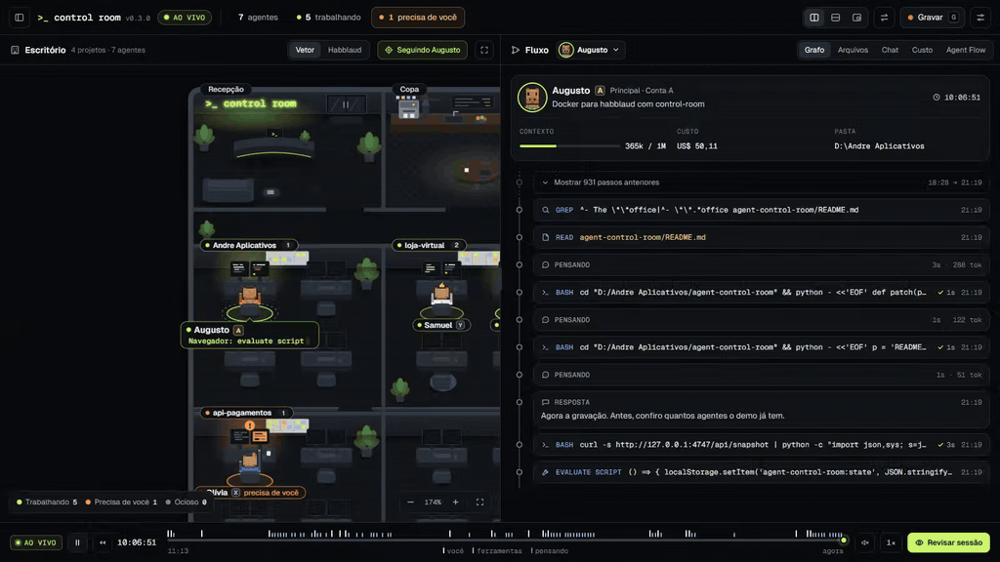

# Agent Control Room

**Uma tela só para ver seus agentes do Claude Code ao vivo.** À esquerda, um escritório com uma sala para cada projeto e uma mesa para cada agente, e cada agente é uma capivara em pixel art com a sua roupa. À direita, a sessão do agente selecionado como um git graph: suas mensagens, o raciocínio, cada ferramenta, os subagentes saindo num branch e voltando. Feito em cima do [Habblaud](https://github.com/marmottajr/habblaud) e do [Agent Flow](https://github.com/patoles/agent-flow), e as telas originais dos dois ficam a um clique.

[Read in English](README.md)



- O **escritório** mostra *quem* está trabalhando e *como está*: cada capivara tem a sua roupa e o seu chapéu (gorro, boné, fone, laranja ou um pintinho na cabeça), e cada estado tem um gesto (anel lime e código na tela trabalhando, balão de reticências pensando, pata levantada e anel laranja quando precisa de você, tela vermelha num erro), e quem está ocioso sai da mesa e vai para a copa. O botão **Habblaud** troca pelo mundo vivo em pixel art do Habblaud, onde os agentes andam pelo prédio, jogam pingue-pongue e fazem amizades e rivalidades.
- O **fluxo** mostra *o que* eles fazem, com os números reais do arquivo da sessão: contexto usado, custo, `+/-` linhas em cada edição, quanto tempo cada comando levou, ferramentas e tokens de cada subagente. Abas **Arquivos**, **Chat** e **Custo**, e a aba **Agent Flow** com o grafo original do Agent Flow.
- A **barra lateral** põe no topo quem precisa de você (com o comando esperando aprovação), lista projetos e agentes e mostra os limites de 5 horas e da semana de cada conta.

Tudo vem neste repositório: clone (ou baixe o ZIP), clique duas vezes no `start.cmd` e pronto. A única coisa que precisa estar instalada é o Node.js.

É um projeto independente. Ele traz os builds oficiais das duas ferramentas, sem alteração, roda os dois juntos e desenha a própria interface em cima dos dados deles.

## O que ele faz

- **Um clique** liga tudo e abre o navegador. Nada mais para instalar: sem Docker e sem instalar cada ferramenta separado.
- **Três layouts**: lado a lado, empilhado (um em cima do outro, feito para vídeo vertical 9:16) e flutuante (o fluxo sobre o escritório, que você arrasta e redimensiona).
- **Trocar** os dois de lugar e **arrastar o divisor** (duplo clique divide ao meio). Os painéis nunca recarregam quando o layout muda.
- **Seguir** um agente (a câmera do escritório mantém ele no meio) ou **Localizar** pela barra lateral. Zoom pela rodinha ou pelos botões, arraste para mover.
- **Barra de reprodução**: a sessão numa linha do tempo. Pausar congela o fluxo, a linha do tempo volta e avança, **Revisar sessão** reproduz em 0,5×, 1×, 2× ou 4×.
- **Modo gravação** esconde as barras e a barra lateral. Passe o mouse no topo, aperte `G` ou `Esc` para elas voltarem.
- Inglês ou português, conforme o idioma do navegador.

| Tecla | Ação |
|---|---|
| `1` `2` `3` | lado a lado / empilhado / flutuante |
| `T` | trocar os painéis |
| `G` | modo gravação (`Esc` sai) |
| `/` | buscar agentes e projetos |

Os atalhos valem com o foco na sala. Depois de clicar dentro de um painel, clique na barra de cima antes.

## Requisitos

- [Node.js](https://nodejs.org/) 22.12 ou mais novo
- [Claude Code](https://claude.com/claude-code)

Testado no Windows 11. macOS e Linux devem funcionar com `npm start`, mas ainda não foram testados.

## Instalar e rodar

```bash
git clone https://github.com/andrefelipevsilva/agent-control-room.git
cd agent-control-room
```

Ou use **Code → Download ZIP** no GitHub e descompacte.

Depois clique duas vezes no **`start.cmd`** (Windows), ou rode `npm start`. A sala abre em `http://localhost:4800/control-room/`. Abra uma sessão do Claude Code em outro terminal e veja ela aparecer dos dois lados.

`Ctrl+C` (ou fechar a janela) para a sala e as ferramentas que ela ligou. Um container Docker do Habblaud continua ligado, como já acontece normalmente.

### Ou deixe o Claude Code instalar

Cole isto no Claude Code e ele baixa, confere o Node e abre a sala para você:

```text
Instale e abra o Agent Control Room (github.com/andrefelipevsilva/agent-control-room) no meu computador:
1. Confira se tenho o Node.js 22.12 ou mais novo (node -v). Se não tiver, me mostre como instalar pelo nodejs.org e pare aqui.
2. Baixe o repositório para a minha pasta pessoal com git clone https://github.com/andrefelipevsilva/agent-control-room.git (sem git, baixe e descompacte o ZIP do main).
3. Abra a sala numa janela própria, para ela continuar rodando depois que você terminar: no Windows, o start.cmd da pasta pelo caminho completo; no Mac ou Linux, npm start dentro da pasta.
4. Quando abrir, me passe o endereço http://localhost:4800/control-room/
```

### Já usa o Habblaud com Docker?

A sala acha. Se algo já responde na porta do Habblaud ou do Agent Flow, a sala usa como está. Se o Docker estiver rodando e o container `habblaud` existir, a sala liga esse container no lugar do build empacotado. `HABBLAUD_MODE=docker` ou `HABBLAUD_MODE=bundled` escolhe um dos dois.

## O que vem no repositório

| Caminho | O que é |
|---|---|
| `server.mjs` | A sala: liga as duas ferramentas e serve a página. Node puro, sem dependências. |
| `session.mjs` | Lê os arquivos de sessão do Claude Code para o fluxo (aos poucos, só o que foi acrescentado). |
| `public/` | A página da sala: escritório, fluxo, barra lateral e barra de reprodução (módulos ES puros, sem build). Fontes Geist sob a SIL OFL. |
| `start.cmd` | Atalho do Windows. |
| `vendor/habblaud/` | Habblaud v1.0.3, build oficial, sem alteração. |
| `vendor/agent-flow/` | Agent Flow v0.9.2, build oficial, sem alteração. |
| `scripts/vendor.mjs` | Refaz a pasta `vendor/` a partir dos repositórios oficiais. |

O [`vendor/README.md`](vendor/README.md) traz os commits exatos de cada projeto. Para conferir os builds você mesmo, ou para ir para versões novas, mude as versões no `scripts/vendor.mjs` e rode `npm run vendor` (precisa de git e internet).

## Configuração

| Variável | Padrão | O que faz |
|---|---|---|
| `ACR_PORT` | `4800` | Porta da sala |
| `HABBLAUD_PORT` | `4747` | Porta do Habblaud |
| `HABBLAUD_MODE` | `auto` | `auto`, `bundled` (sempre o build do `vendor/`) ou `docker` (o container do próprio Habblaud) |
| `HABBLAUD_APP` | `vendor/habblaud/dist/server/index.js` | Outro build do Habblaud para rodar no lugar (o `dist/server/index.js` de um clone seu); no `auto`, vale antes do Docker |
| `AGENT_FLOW_PORT` | `3001` | Porta do Agent Flow |
| `AGENT_FLOW_WORKSPACE` | escolhida pelas suas sessões recentes | Pasta que o Agent Flow observa: sessões abertas nela ou nas subpastas aparecem no grafo (veja abaixo) |
| `AGENT_FLOW_TELEMETRY` | `false` | Telemetria anônima do Agent Flow, desligada a menos que você ligue |
| `AGENT_FLOW_APP` | `vendor/agent-flow/app.js` | Outro build do Agent Flow para rodar no lugar |

As variáveis do próprio Habblaud também valem, por exemplo `HABBLAUD_WORLD=0` (esconde o Habblaud World) ou `HABBLAUD_PTY=1` (terminal interativo, que precisa da instalação completa do Habblaud). A sala desliga o aviso de versão nova do Habblaud (`HABBLAUD_UPDATE_CHECK=0`), porque as versões novas chegam por este repositório.

`--no-open` liga a sala sem abrir o navegador.

**Quais sessões aparecem no Agent Flow.** O Agent Flow acompanha uma pasta e as subpastas dela. Se você não escolher, a sala olha as sessões do Claude Code que você usou na última semana e escolhe a pasta que abrange a maioria delas (por exemplo `D:\trabalho` quando você trabalha em `D:\trabalho\app` e `D:\trabalho\site`). O log da sala mostra a pasta, e a dica da luz do Agent Flow na barra de cima também. Para escolher outra: `start.cmd --workspace "D:\outra\pasta"` ou `AGENT_FLOW_WORKSPACE`.

## Como funciona

```
navegador ── http://localhost:4800 ── Agent Control Room (Node, só 127.0.0.1)
                                       ├── /control-room/         → a página da sala
                                       ├── /control-room/session  → os passos de uma sessão, do arquivo dela
                                       └── todo o resto           → Habblaud (127.0.0.1:4747)
            iframe ─────────────────── Agent Flow (127.0.0.1:3001), na aba Agent Flow
```

As duas ferramentas rodam a partir do `vendor/`, com o mesmo Node que roda a sala.

O escritório, a barra lateral e o cabeçalho vêm do fluxo ao vivo do Habblaud (`/api/stream`): agentes, estado e passo atual, projetos, contas e limites de uso. O fluxo vem do próprio arquivo da sessão (`~/.claude/projects/...`), lido pelo servidor da sala: é lá que estão os tokens reais, o tempo de raciocínio, os diffs e os arquivos dos subagentes. As sessões que ele não consegue ler (Codex) usam o histórico de atividades do Habblaud.

O Habblaud proíbe ser embutido em outras páginas (`X-Frame-Options: DENY`). A sala serve o Habblaud por um proxy pequeno na própria origem e troca esse cabeçalho por `SAMEORIGIN`. Só a página da sala, na mesma origem, consegue embuti-lo; sites de terceiros continuam sem conseguir. O resto segue como o Habblaud manda. As travas de "só pelo próprio computador" dele (terminal, pedidos de permissão, mensagens) continuam passando: o proxy mantém o `Host` original e as requisições continuam na mesma origem. O Habblaud na porta dele (4747) não muda nada.

O Agent Flow não manda restrição de embutir, então a sala embute direto pelo endereço dele.

## O que roda no seu computador

- O **Agent Control Room** escuta só em `127.0.0.1` e não manda nada para lugar nenhum. Para desenhar o fluxo, ele lê o arquivo da sessão do agente que você seleciona; esse endereço só responde a páginas deste computador.
- O **Habblaud** lê os arquivos de sessão do Claude Code (e do Codex) e guarda os dados dele em `~/.habblaud`. Os extras dele, como o uso do plano ao vivo e responder permissões pelo escritório, precisam do mod dele no Claude Code, que vem com a [instalação completa do Habblaud](https://github.com/marmottajr/habblaud#readme).
- O **Agent Flow**, na primeira vez que roda, adiciona hooks ao `~/.claude/settings.json` para o Claude Code mandar os eventos para ele. É a instalação do próprio Agent Flow; veja o README dele. A sala liga ele com a telemetria desligada.

## Créditos

- [Habblaud](https://github.com/marmottajr/habblaud), de Márcio Junior, licença MIT.
- [Agent Flow](https://github.com/patoles/agent-flow), de Simon Patole, licença Apache 2.0. "Agent Flow" é uma marca de Simon Patole.
- [Geist e Geist Mono](https://vercel.com/font), da Vercel, SIL Open Font License 1.1 (`public/fonts/OFL.txt`).

Os builds deles em `vendor/` são redistribuídos sob as licenças deles; cada pasta mantém o `LICENSE` e um `THIRD_PARTY_NOTICES.md` com os pacotes que vão dentro. O Agent Control Room não tem vínculo com nenhum dos dois projetos nem é endossado por eles. Os dados ao vivo do escritório vêm do Habblaud, a visão "Habblaud" é o próprio mundo do Habblaud e a aba "Agent Flow" é o próprio grafo do Agent Flow; o crédito deles é todo dos autores.

## Licença

[MIT](LICENSE), para o código do Agent Control Room. Tudo em `vendor/` mantém a licença de cada projeto.
